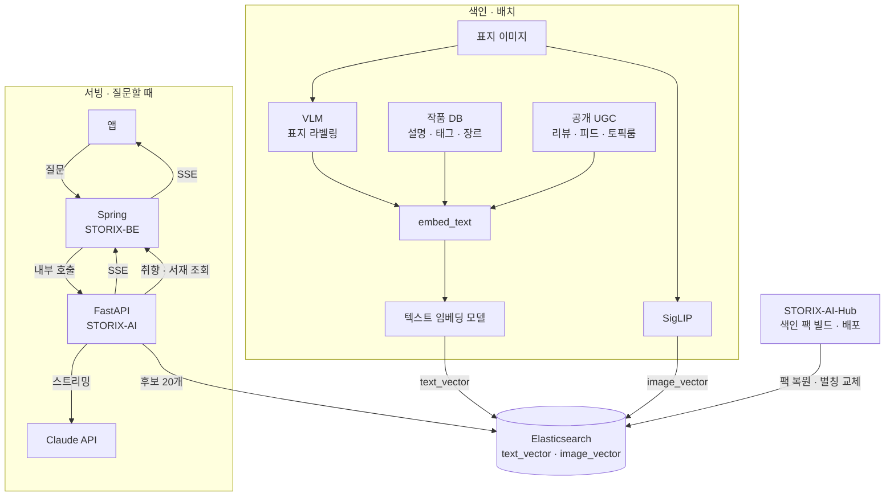

<h1>

STORIX-AI
</h1>

> 이야기에 대한 이야기로 모두가 연결되는 이 곳! 데이터로 취향을 연결하는 웹툰·웹소설 팬덤 플랫폼, STORIX

<br>

STORIX 의 AI 작품 검색 서버입니다. "계약결혼 로판 중에 완결된 거"처럼 말로 물어보면, 미리 색인한 작품에서 후보를 찾고 Claude 가 그중 최대 5개를 골라 추천합니다.

```
앱 ──질문──▶ STORIX-BE (Spring) ──내부 호출──▶ STORIX-AI (FastAPI) ──▶ Elasticsearch · Claude
   ◀──SSE──                      ◀──SSE──
```

- 앱은 STORIX-AI 를 직접 부르지 않습니다. 로그인 · 사용 횟수 · 대화 기록 · 작품 검증은 Spring 이 합니다
- 작품은 `recommend_works` 도구로 넘긴 작품 ID 로만 추천합니다. 후보에 없는 작품은 말하지 않습니다
- 색인 팩 빌드 · 배포는 비공개 레포 STORIX-AI-Hub 에서 합니다. 이 레포에는 데이터를 두지 않습니다

## 🛠️ Tech Stack

<table>
  <tr>
    <td align="center"><b>Language</b></td>
    <td>
      
    </td>
  </tr>
  <tr>
    <td align="center"><b>Serving</b></td>
    <td>
      
      
      
      
    </td>
  </tr>
  <tr>
    <td align="center"><b>LLM</b></td>
    <td>
      
      
    </td>
  </tr>
  <tr>
    <td align="center"><b>Search</b></td>
    <td>
      
      
    </td>
  </tr>
  <tr>
    <td align="center"><b>Indexing</b></td>
    <td>
      
      
      
    </td>
  </tr>
  <tr>
    <td align="center"><b>테스트 · 평가</b></td>
    <td>
      
      
    </td>
  </tr>
</table>

## 🧭 Architecture



| 단계 | 하는 일 |
|---|---|
| ① 조건 추출 | Haiku 가 질문에서 작품 유형 · 완결 · 소재 · 분위기를 뽑음 |
| ② 필터 | 19금 · 작품 유형 같은 정책값은 Spring 이 넘긴 값만 씀 |
| ③ 검색 | kNN + BM25 하이브리드, RRF 로 합쳐 후보 20개 |
| ④ 답변 | Sonnet 이 후보와 단서만 보고 최대 5개를 `recommend_works` 로 고름 |
| ⑤ 스트리밍 | `progress` → `token` → `works` → `done` / `error` |

## 📚 Docs

| 문서 | 내용 |
|---|---|
| [기술 구조](docs/architecture.md) | 전체 구조 · 검색 파이프라인 · 구성 요소 · 응답 흐름 · 인프라 제약 |
| [색인과 임베딩](docs/indexing.md) | 임베딩 · 데이터별 색인 · 표지 라벨 · VLM vs SigLIP · Elasticsearch |
| [서빙과 스트리밍](docs/serving.md) | FastAPI · DB 커넥션 · 사용자 데이터 접근 · SSE · 프롬프트 · 대화 기억 |
| [레포와 API 계약](docs/api-contract.md) | API · SSE 이벤트 · 최종 응답 · 색인 결과 형식 · 평가 결과 형식 |
| [온보딩 · 챗봇 설정](docs/onboarding.md) | 첫 대화 흐름 · 기본 멘트 · 설정 · 검색 반영 규칙 |
| [MVP 데이터](docs/mvp-data.md) | 추천에 쓰는 작품 · 사용자 · 대화 데이터 |
| [개발 계획](docs/plan.md) | 단계 · 기술 스택 · 정책 · 단계별 할 일 · 기대 결과 |
| [역할 분담](docs/roles.md) | 작업 목록 · 작업 순서 |
| [결정 기록](docs/decisions) | 날짜와 이유를 같이 남긴 결정 |

개발 규칙은 [AGENTS.md](AGENTS.md), 브랜치 · PR · 릴리스 규칙은 [agents/conventions/git.md](agents/conventions/git.md) 에 있습니다.

## 📂 File Structure

```
.
├── serving/          # 검색 API · 파이프라인 단계 · 답변 레이어 · SSE 변환
├── indexing/
│   ├── labeling/     # VLM 표지 라벨링
│   ├── image_embed/  # SigLIP → image_vector
│   └── text_embed/   # embed_text → text_vector
├── prompts/          # 프롬프트 (git 으로 버전 관리)
├── eval/             # 채점 스크립트 (평가 세트 원본은 커밋 안 됨)
├── schemas/          # 주고받는 형식 정의 (계약의 원본)
└── docs/             # 설계 문서
```

<br>

## 🛠️ Developers

|  |  |
|:---:|:---:|
| __이수아<br>[@Immmii](https://github.com/Immmii)__ | __이채연<br>[@codus02](https://github.com/codus02)__ |
| 개발 환경 · CI · 인프라 · Hub 배포 <br/> Spring 연동 · API 계약 · SSE 스트리밍 | 임베딩 · 색인 · 검색 <br/> 프롬프트 · 평가 세트 · 채점 |
