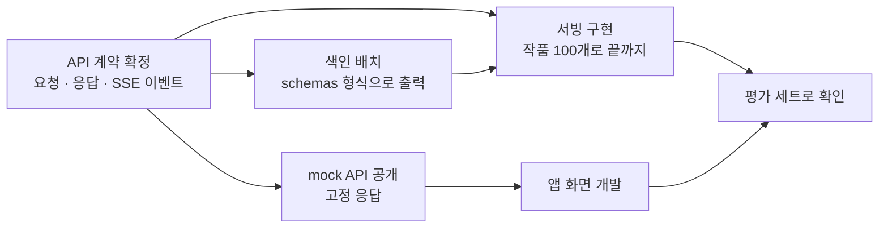

# 레포와 API 계약

형식의 원본은 `schemas/` 다. 이 문서는 초안이고, 확정되면 `schemas/` 와 맞춘다.

## 1. 레포: STORIX-AI

- 서빙뿐 아니라 라벨링 · 임베딩 배치, 평가, 프롬프트까지 들어가서 BE 를 뺀 중립적인 이름 STORIX-AI 사용
- 프레임워크는 FastAPI (스트리밍, 비동기, Pydantic 스키마와 OpenAPI 자동 생성, LLM 생태계)

```
STORIX-AI/
├── indexing/
│   ├── labeling/      VLM 표지 라벨링
│   ├── image_embed/   SigLIP → image_vector
│   └── text_embed/    embed_text → text_vector
├── serving/           검색 API, 파이프라인 단계, 답변 레이어, SSE 변환
├── prompts/           프롬프트 (git 으로 버전 관리)
├── eval/              채점 스크립트 (평가 세트 원본은 커밋하지 않음)
└── schemas/           주고받는 형식 정의
```

- 영역별 담당은 README 첫 부분에 적고, serving · schemas · eval 처럼 형식에 영향을 주는 폴더는 CODEOWNERS 로 리뷰를 거치게 함

## 2. API

| 구분 | API | 설명 |
| --- | --- | --- |
| 앱 → Spring | `POST /api/v1/ai-search/chats` | 대화방 만들기. 온보딩을 안 봤으면 온보딩을 같이 내려줌 |
| 앱 → Spring | `POST /api/v1/ai-search/chats/{chatId}/messages` | 질문 보내기. SSE 응답 |
| 앱 → Spring | `GET /api/v1/ai-search/chats/{chatId}/messages` | 지난 대화 보기 (UI 는 전부 보여 줌) |
| 앱 → Spring | `GET · PUT /api/v1/ai-search/settings` | 챗봇 설정 (19금 추천 on/off · 기본 작품 유형) |
| 앱 → Spring | `GET /api/v1/ai-search/examples` | 예시 질문 |
| Spring → AI | `POST /internal/search/stream` | 질문 · 대화 맥락 · 사용자 설정 전달, SSE 응답 |
| Spring → AI | `POST /internal/index/works` | 작품 증분 색인 · 삭제 |
| AI → Spring | `GET /internal/users/{userId}/context` | 취향 장르 · 해시태그, 서재 · 관심작품 ID |

## 3. SSE 이벤트

`progress` → `token` (여러 번) → `works` (최대 5개) → `done` / `error`

```
event: progress
data: {"step":"SEARCHING","message":"작품 찾는 중…"}

event: progress
data: {"step":"FOUND","message":"후보 12개 찾음"}

event: token
data: {"text":"은발 꼬마와 "}

event: token
data: {"text":"흑발 귀족 보호자가 나오는 육아물 위주로 골라 봤어요."}

event: works
data: {"recommendedWorks":[{"rank":1,"workId":123,"title":"…","thumbnailUrl":"…","platform":"카카오페이지","matchedClues":[{"text":"은발 보라 눈 유아","source":"COVER"}]}],"pipelineVersion":"v1.0"}

event: done
data: {"chatId":12,"messageId":31}
```

| 이벤트 | 앱에서 할 일 |
| --- | --- |
| progress | 진행 표시 ("작품 찾는 중…") |
| token | 말풍선에 글자 이어 붙이기 |
| works | 작품 카드 그리기 (배열 순서 = 추천 순위) |
| done | 입력창 다시 켜기 |
| error | 오류 화면 |

- `title` · `thumbnailUrl` · `platform` 은 Spring 이 DB 값으로 채운다. AI 서버는 `workId` · 이유 · 단서만 보낸다
- `messageId` · `pipelineVersion` · `rank` 는 GA 이벤트와 서버 기록을 이어 붙이는 키

## 4. 최종 응답 (대화 기록 조회 형식)

스트리밍이 끝난 뒤의 최종 상태. 대화 기록 API 도 이 모양으로 돌려줌

```json
{
  "message": "은발 꼬마와 귀족 보호자가 나오는 육아물이에요.",
  "works": [
    { "workId": 123, "title": "…", "platform": "카카오페이지",
      "matchedClues": [{ "text": "은발 보라 눈 유아", "source": "COVER" }] }
  ],
  "status": "OK"
}
```

| status | 의미 | 화면 |
| --- | --- | --- |
| OK | 정상 답변. works 가 있으면 카드형 | 작품 추천 대화 (작품 있음) / text 대화 (작품 없음) |
| NO_RESULT | 맞는 작품 없음. 조건을 더 물어봄 | text 대화 |
| OFF_TOPIC | 작품 외 질문 | text 대화 |
| ERROR | 오류 · 한도 초과 | 오류 |

- `matchedClues.source` 는 단서가 어디서 왔는지 (COVER, DESCRIPTION, REVIEW 등). 기획서의 "일치 단서의 출처 표기 방식" 논의와 연결
- 온보딩 멘트와 선택 결과는 UI 대화 기록에 `type: ONBOARDING` 으로 남김 ([onboarding.md](onboarding.md))

## 5. 색인 결과 형식

| 구분 | 항목 |
| --- | --- |
| 입력 | work_id, 설명, 태그, 장르 (v2: 표지 URL) |
| 출력 | work_id, embed_text, text_vector, 모델 이름 · 버전 (v2: 라벨 JSON, image_vector) |

- 라벨 항목 정의와 embed_text 규칙도 여기에 문서로 둠
- 형식이 같으면 안에서 어떤 모델을 쓰든 서빙 쪽은 그대로 동작

## 6. 개발 순서



- 계약 먼저, 양쪽 동시에: 계약을 확정하고 고정 응답을 돌려주는 mock API 를 먼저 열면, 앱은 서버를 기다리지 않고 화면을 끝까지 만들 수 있음
- 중간에 만나는 지점은 API 계약과 평가 세트뿐
- 작은 데이터(작품 100개)로 끝까지 도는 기본 버전을 먼저 완성하고, 그다음 전체로 늘림

## 7. 평가 · 채점 결과 형식

- "더 좋아졌다"는 말이 아니라 같은 평가 세트의 숫자로 판단
- 평가 세트: 질문 → 정답 작품. 예시 질문, 이상한 질문(작품 외 질문, 탈옥 시도, 19금 우회)도 포함

| 지표 | 보는 것 |
| --- | --- |
| Recall@10 | 정답 작품이 후보 10개 안에 들었나 (검색) |
| MRR | 정답이 몇 번째에 나왔나 (검색) |
| 추천 Precision | 추천한 작품 중 맞는 비율 (답변) |
| 후보 밖 작품 비율 | 후보에 없는 작품을 말한 비율 (답변) |
| 라벨 정확도 | 표지 라벨이 실제와 맞나 (색인) |

- 바꿀 때마다 "무엇을 바꿨더니 몇 % 올랐다"를 표로 남김
- 실패한 답변은 원인(검색 누락, 라벨 오류, 프롬프트, 모델)별로 분류해 개선 순서를 정함
- 채점 스크립트(`eval/`)는 CLI 한 번으로 돌고 결과를 JSON 으로 낸다. PR 평가 · Hub 평가 게이트 · 출시 기준 측정이 같은 형식을 쓴다. 항목은 AI-02 에서 확정한다
- 출시 · 배포 기준은 [plan.md](plan.md)
