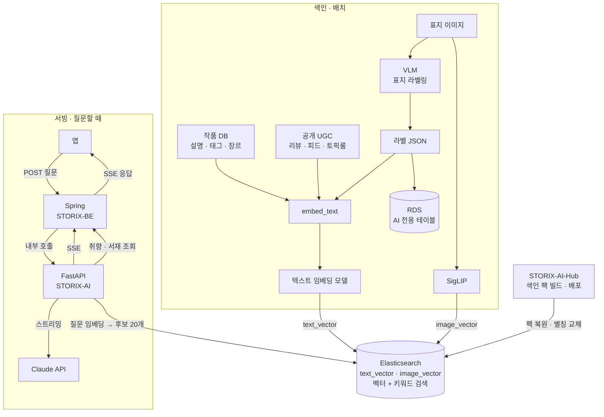
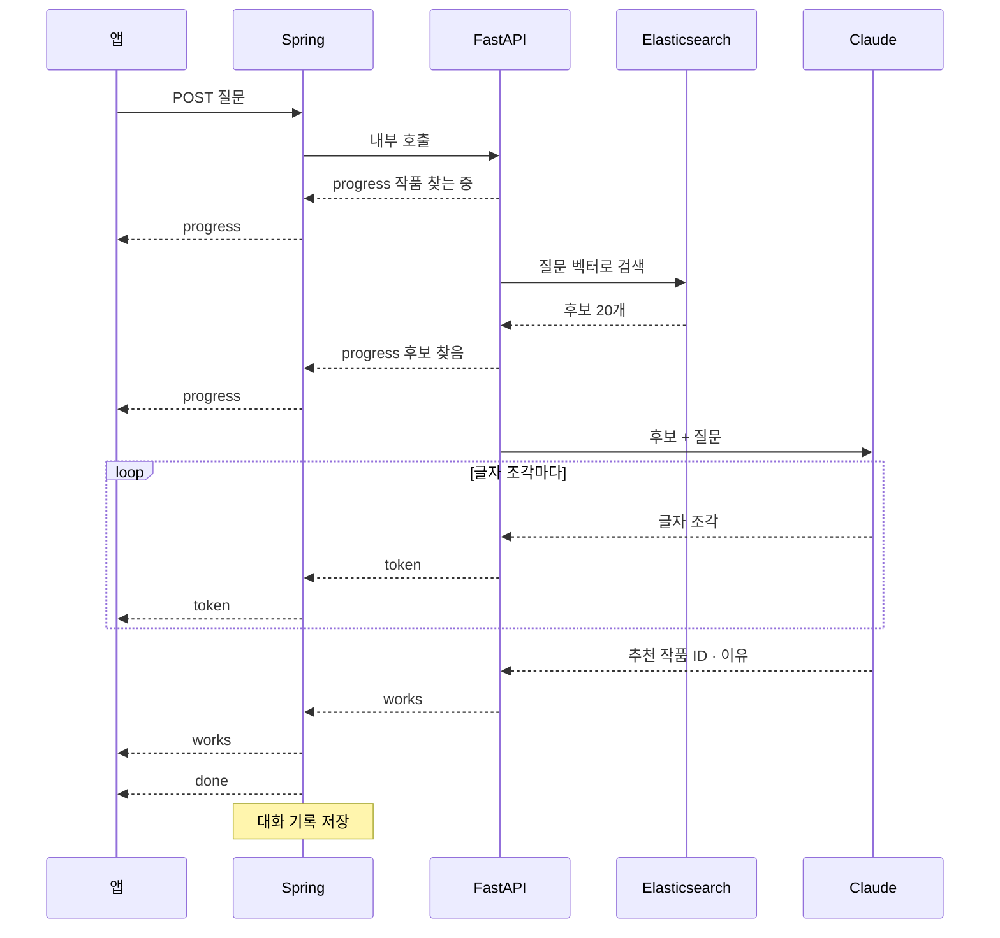

# 기술 구조

## 1. 개요

- 사용자의 자연어 질문을 받아 작품 후보를 찾고, AI 가 후보만 바탕으로 답하는 구조(RAG)
- 작품 정보 · 공개 UGC · 표지 특징은 미리 검색 가능한 형태(벡터)로 색인해 두고, 질문이 오면 가까운 작품을 찾음
- 두 갈래
  - **색인**: 배치로 미리 만들어 둠. 작품 적재 때 증분 반영, 알고리즘을 바꿀 땐 STORIX-AI-Hub 로 전체 재색인
  - **서빙**: 질문이 들어올 때 돌아감

## 2. 전체 구조

1. 앱이 Spring 에 질문을 보냄. Spring 은 로그인 확인과 사용 횟수 검사
2. Spring 이 FastAPI 를 내부로 호출. FastAPI 는 외부에 열지 않음
3. FastAPI 가 질문에서 조건을 뽑고, 벡터로 바꿔 Elasticsearch 에서 비슷한 작품 20개 정도를 찾음
4. 후보와 질문을 Claude 에 넘겨 답변을 스트리밍으로 받음. 필요하면 Spring 내부 API 로 사용자 취향 조회
5. FastAPI → Spring → 앱 순서로 응답이 흐르고, Spring 이 마지막에 작품을 검증하고 대화 기록 저장

## 3. 검색 파이프라인

알고리즘 업데이트는 이 단계를 바꾸거나 추가하는 것. 단계마다 버전을 붙여 응답 로그에 남김 (`pipeline_version`)

| 단계 | 하는 일 | MVP | v2 |
| --- | --- | --- | --- |
| ① 조건 추출 | 자연어 → 작품 유형 · 장르 · 완결 · 소재 · 분위기 · 범위 밖 여부 | Haiku tool use 로 JSON 추출 | 조건 항목 추가 |
| ② 필수 필터 | 성인 · 완결 · 작품 유형 · 서재에 있는 작품 제외 | O | O |
| ③ 후보 검색 | 벡터 + 키워드(BM25) 검색 후 점수 합치기(RRF) | 작품 설명 · 태그 · 장르 | + 표지 라벨 · 공개 UGC |
| ④ 후보 묶기 | 같은 작품을 가리키는 문서를 작품 ID 로 합치기 | - (작품당 문서 1개) | UGC 를 따로 색인하면서 필요 |
| ⑤ 재순위 | 조건 일치율 · 관련성으로 다시 정렬 | - | 재순위 모델 또는 규칙 점수 + 인기 점수 |
| ⑥ 근거 검증 | 추천 근거가 실제로 있는지, 공개 글인지 확인 | 작품 ID 가 후보 안에 있는지 | + 단서 출처 · 스포일러 |
| ⑦ 답변 | 후보 중 최대 5개를 골라 이유와 함께 답변 | Sonnet 스트리밍 + `recommend_works` 도구 | 프롬프트 · 모델 조정 |

조건 우선순위: 질문에 직접 말한 조건 > 사용자가 설정해 둔 기본 작품 유형(온보딩에서 정함). 세부 규칙은 [onboarding.md](../plan/onboarding.md)

## 4. 구성 요소

| 구성 요소 | 하는 일 | 핵심 결정 |
| --- | --- | --- |
| 색인 (`indexing/`) | 표지 라벨링, 벡터 생성, ES 적재, 증분 반영 | VLM 은 로컬 모델. 작품 ID 를 문서 ID 로 써서 바뀐 작품만 다시 넣음. 모델을 바꿀 땐 새 인덱스를 다 채운 뒤 별칭만 교체 |
| Elasticsearch | 후보 검색 | 텍스트 벡터 · 이미지 벡터. 성인 · 완결 · 플랫폼은 필터, 벡터 + BM25 하이브리드 |
| RDS AI 전용 테이블 | 라벨 원본 보관 | 별도 NoSQL 서버는 두지 않음 |
| FastAPI (`serving/`) | 조건 추출, 질문 임베딩, 검색, Claude 호출, 응답 스트림 변환 | 외부에 열지 않음. Spring 만 호출. 프롬프트는 `prompts/` 에서 git 으로 관리 |
| Spring (STORIX-BE) | 입구와 마지막 검증 | 인증 · 사용 횟수, 후보 밖 작품 제거, 제목 · 표지 · 플랫폼은 DB 값으로 채움, 대화 저장 |
| 내부 API | AI 가 사용자 맥락 조회 (취향, 서재 · 관심작품) | 사용자 ID 는 Spring 이 로그인 토큰에서 꺼낸 값만. 외부 호출 차단. 늦으면 맥락 없이 답변 |
| Claude API | 안내 문구, 추천 작품 ID 와 이유 | 작품은 도구(tool use)로만 받아 없는 작품을 지어내지 못하게 함. 작품 외 질문 차단, 프롬프트 캐싱 |
| 대화 기억 | "아까 두 번째 거", "그거 말고" 같은 이어지는 질문 | 대화 기록(MySQL)에서 질문마다 최근 25건 + 이미 보여 준 작품을 읽어 넘김. 사용자 조건은 AI-06 에서. 이전 대화는 요약 (v2) |
| STORIX-AI-Hub (비공개) | 전체 재색인 팩 빌드 · 평가 · 배포 | 매니페스트 PR → 평가 게이트 → 스냅샷 복원 → 별칭 교체 |

## 5. 색인

작품 정보 · 공개 UGC · 표지를 작품 ID 별로 색인. 자세한 내용은 [indexing.md](indexing.md)

- embed_text: 라벨 전체 대신 검색에 잘 걸리도록 핵심만 문장으로 정리한 것
- 작품과 질문은 반드시 같은 임베딩 모델로 변환. 모델을 바꾸면 전체 재색인
- 라벨링은 기존 모델에 표지를 보여 주고 묻는 것이라 모델 학습에 해당하지 않음

## 6. 응답 흐름

한 번에 JSON 하나가 오는 게 아니라 작은 이벤트가 순서대로 옴(SSE). 이벤트 형식은 [api-contract.md](api-contract.md), 변환 방식은 [serving.md](serving.md)

- 토픽룸 채팅은 WebSocket, AI 답변은 SSE. 서버 → 앱 한 방향이고 답변 하나가 끝나면 닫힘
- EventSource 는 GET 만 지원해서 앱은 POST 스트리밍(fetch 스트림 또는 SSE 라이브러리) 사용
- FE 와 맞출 것: SSE 이벤트 형식, 진행 표시 · 스트리밍 글자 · 카드 스켈레톤

## 7. 인프라 제약

- Elasticsearch 는 운영 서버(메모리 4GB) 안에서 1GB 로 동작 중. 벡터 인덱스를 같은 곳에 올리면 메모리 부족 위험
- DB(RDS)는 메모리 1GB 로 여유가 거의 없음. AI 전용 테이블도 같은 DB 에 두면 부담 증가
- 답변 스트리밍 동안 DB 커넥션을 잡지 않음. 인증 · 횟수 확인은 짧게 끝내고, 대화 저장은 스트림이 끝난 뒤 따로
- 앱 서버는 2 vCPU 라 임베딩 계산 · 재색인을 서비스 서버에서 돌리면 응답이 느려짐. 전체 재색인은 Hub 에서 만들어 붙임

## 8. 정해진 것 · 남은 것

| 항목 | 상태 |
| --- | --- |
| 후보 개수 · 카드 노출 | 후보 20개 중 카드 최대 5개 |
| 신규 작품 · UGC 반영 주기 | 최대한 바로 반영 |
| 대화 기억 | 탈퇴 시까지 보관, 최근 25건 기억. 그 이전은 요약 → 검색 색인 후 답변에 반영 |
| 임베딩 모델 | 미정. AGENTS.md 논의 중 참고 |
| Elasticsearch 위치 | 미정 (지금 서버에 같이 vs 분리) |

평가는 질문 → 정답 작품 평가 세트를 먼저 만들고, 모델 · 프롬프트를 바꿀 때마다 같은 세트로 비교. 지표는 [plan.md](../plan/README.md)

## 하위 문서

| 문서 | 내용 |
| --- | --- |
| [색인과 임베딩](indexing.md) | 임베딩 · 데이터별 색인 · 표지 라벨 · VLM vs SigLIP · Elasticsearch · 저장 위치 |
| [서빙과 스트리밍](serving.md) | FastAPI · DB 커넥션 · 사용자 데이터 접근 · SSE · 답변 레이어 · 프롬프트 · 대화 기억 |
| [레포와 API 계약](api-contract.md) | 레포 구조 · API · SSE 이벤트 · 최종 응답 · 색인 결과 형식 · 평가 결과 형식 |

---

작성자 : 이수아

업데이트 날짜 : 2026-11-20
