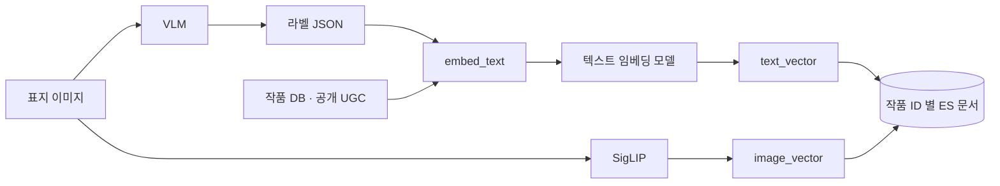

# 색인과 임베딩

> 상위 문서: [기술 구조](README.md) · 같은 묶음: [서빙과 스트리밍](serving.md) · [레포와 API 계약](api-contract.md)

## 1. 임베딩

- 글(또는 이미지)을 숫자 목록(벡터)으로 바꾸는 것. 뜻이 비슷하면 벡터도 가까움. 두 벡터가 얼마나 가까운지로 뜻이 얼마나 비슷한지 계산

```
"은발 꼬마랑 흑발 귀족 아빠 나오는 육아물"  → [0.12, -0.87, 0.33, ... ]
"보라 눈 유아와 귀족 보호자, 가족물 로판"   → [0.11, -0.85, 0.35, ... ]  ← 거의 비슷
"회귀한 검사의 복수극"                     → [-0.64, 0.22, -0.91, ... ] ← 완전 다름
```

- 키워드 검색(지금 STORIX 검색)은 글자가 같아야 찾지만, 임베딩 검색은 뜻으로 찾아서 "은발 = 은빛 머리 = 백발"을 비슷하게 봄
- 흐름: 작품마다 설명 · 태그 · 리뷰 · 표지 라벨을 미리 임베딩해 저장 → 질문도 같은 방식으로 벡터화 → 가장 가까운 작품 20개 정도를 후보로 → Claude 가 후보와 단서만 보고 정리. 이 전체가 RAG
- **Claude API 에는 임베딩 기능이 없다.** 유료 API(Voyage AI 등) 또는 로컬 모델(bge-m3, multilingual-e5, 한국어 특화 모델) 중 골라야 함. 로컬 모델을 서버에서 돌리면 비용 0원

꼭 맞출 것

1. 작품과 질문은 같은 모델로 임베딩. 모델을 바꾸면 전체 재색인(Hub)
2. 질문 임베딩은 서빙 서버에서 돌아서 서버 CPU · 메모리에 맞는 크기여야 함 (양자화 · ONNX 검토)
3. embed_text 규칙을 문서로 남기기
4. 넘기는 형식: 모델 이름 · 버전, 차원 수, 파일 형식

## 2. 데이터별 색인

| 데이터 | 색인 방법 | 쓰이는 곳 | 단계 |
| --- | --- | --- | --- |
| 작품 DB | 설명 · 태그 · 장르를 embed_text 로 | AI 작품 검색 | MVP |
| 표지 | VLM 이 인물 외형 · 의상 · 배경 · 소품을 라벨 JSON 으로 → embed_text | AI 작품 검색, 카드의 일치 단서 | v2 |
| 공개 UGC | 리뷰 → 피드 → 토픽룸 순서로 본문을 embed_text 에. 삭제 · 비공개 전환 시 색인에서도 제거 | AI 작품 검색 | v2 |
| 표지 그림체 | SigLIP 이 그림체 · 분위기를 이미지 벡터로 | 작품 상세 "그림체 비슷한 작품" | 3단계 |



## 3. 표지 라벨과 embed_text

VLM 이 표지를 보고 뽑는 라벨 예시

```json
{
  "characters": [
    { "role_guess": "보호자 · 남주급 성인 남성", "age_band": "20대", "hair": "흑발, 앞머리 내린 중단발", "eyes": "적갈색", "outfit": "흰 셔츠, 금색 장식끈이 달린 짙은 남색 제복 망토", "pose_mood": "나른하게 기대 앉음, 귀족적", "confidence": 0.8 },
    { "role_guess": "주인공 · 막내 여아", "age_band": "유아 (4~6세)", "hair": "은발 단발, 딸기 머리핀", "eyes": "보라색", "outfit": "민트색 레이스 원피스, 연두 리본", "pose_mood": "앙증맞음, 비밀스러운 표정", "confidence": 0.85 }
  ],
  "scene": ["귀족 저택 실내", "곰 · 토끼 인형", "파스텔 톤"],
  "embed_text": "흑발 적갈색 눈의 귀족 제복 성인 남성과 은발 보라 눈의 유아 여자아이. 육아물, 가족물, 로판, 파스텔 표지"
}
```

- embed_text: 실제로 임베딩할 문장. 라벨 전체 대신 검색에 잘 걸리도록 핵심만 정리한 것이고, 쓰는 방식에 따라 검색 품질이 달라짐
- 라벨의 구체적인 특징은 결과 카드의 "일치한 단서"로도 씀

## 4. 임베딩은 모델 돌리는 게 끝이 아님

모델 돌리는 건 코드 몇 줄(sentence-transformers 의 encode)이고, 검색 품질은 앞뒤에서 거의 다 결정됨

| 구분 | 할 일 |
| --- | --- |
| 앞단 | embed_text 설계(설명이 길면 표지 특징이 묻히고, 태그만 넣으면 분위기를 못 잡음), 작품당 벡터 1개 vs 여러 개(설명용 · 표지용 · 리뷰용), 긴 글 쪼개기, 스포일러 · 욕설 · 정보 없는 리뷰 제거 |
| 뒷단 | 하이브리드 검색(벡터는 제목 · 작가명 같은 정확한 단어에 약해서 BM25 와 섞음), 필터(완결 · 플랫폼 · 성인 제외), 재순위(로컬 모델 가능), 새 작품 · 리뷰만 다시 임베딩하는 증분 처리 |
| 평가 | 선택지마다 좋아졌는지는 평가 세트(질문 → 정답 작품)로 확인 |

## 5. VLM 라벨 vs SigLIP

둘 다 쓴다. 잘하는 게 다름

|  | VLM → 라벨 JSON | CLIP · SigLIP → 벡터 |
| --- | --- | --- |
| 결과 | 글 (속성) | 숫자 (느낌) |
| 잘하는 것 | 머리색 · 눈색 · 의상 같은 구체적 특징 | 그림체 · 분위기 · 색감 |
| 설명 가능 | O (카드의 일치 단서) | X |
| 한국어 질문 | 잘 됨 | 약함 (대부분 영어 위주) |
| 비용 · 속도 | 비싸고 느림 | 싸고 빠름 |

- AI 작품 검색("은발 꼬마 육아물")은 VLM 라벨 → text_vector
- "그림체 비슷한 작품"은 SigLIP → image_vector. 그 작품의 벡터로 가까운 걸 찾으면 돼서 질문 때 모델이 필요 없고 서버 부담이 거의 없음. SigLIP 은 배치 때만 돌림
- "파스텔톤 표지" 같은 분위기 질문을 AI 검색에서 잡으려면 SigLIP 텍스트 인코더도 서버에 올려야 하고 한국어에 약함. 처음엔 빼고 평가 세트로 효과를 본 뒤 추가
- 표지가 많아서 라벨링은 API 보다 로컬 VLM 으로

표지 처리 순서

1. SigLIP 이미지 벡터를 전체 작품에 먼저 (그림체 추천은 이것만으로 바로 가능)
2. VLM 라벨링은 1,000개로 항목 · 품질 확인 후 전체로
3. 라벨이 쌓이는 대로 text_vector 반영

## 6. Elasticsearch

매핑

```json
PUT works_ai_v1
{
  "mappings": {
    "properties": {
      "work_id":      { "type": "long" },
      "title":        { "type": "text" },
      "embed_text":   { "type": "text" },
      "platform":     { "type": "keyword" },
      "completed":    { "type": "boolean" },
      "adult":        { "type": "boolean" },
      "text_vector":  { "type": "dense_vector", "dims": 1024, "index": true, "similarity": "cosine" },
      "image_vector": { "type": "dense_vector", "dims": 768,  "index": true, "similarity": "cosine" }
    }
  }
}
```

적재

```python
from elasticsearch import Elasticsearch, helpers

es = Elasticsearch(ES_URL)
actions = (
    {"_index": "works_ai_v1", "_id": w["work_id"], "_source": {**w, "text_vector": vec.tolist()}}
    for w, vec in zip(works, vectors)
)
helpers.bulk(es, actions, chunk_size=500)
```

검색

```json
POST works_ai/_search
{
  "knn": {
    "field": "text_vector",
    "query_vector": [],
    "k": 20,
    "num_candidates": 200,
    "filter": { "term": { "adult": false } }
  }
}
```

- `dims` 는 실제 모델 크기에 맞춤 (bge-m3 는 1024)
- `platform` · `completed` · `adult` 는 필터용. embed_text 를 text 로도 넣어 BM25 하이브리드
- `_id` = `work_id` 로 두면 같은 작품은 덮어써서 증분 반영이 쉬움
- 모델 교체는 별칭으로: `works_ai_v2` 를 다 채운 뒤 `works_ai` 가 가리키는 대상만 교체
- 인덱스는 환경(dev · prod)마다 따로 만들어서 환경 간 작품 ID 차이와 무관

## 7. 저장 위치

| 데이터 | 위치 | 이유 |
| --- | --- | --- |
| 라벨 원본 | RDS AI 전용 테이블 (JSON 컬럼) | 별도 NoSQL 서버는 메모리 · 관리 대상이 늘어서 두지 않음 |
| 검색 색인 | Elasticsearch (라벨 JSON 을 `_source` 에 + 벡터) | kNN + BM25 하이브리드 지원 |
| 공개 UGC | 배치로 ES 에 미리 색인 | 글이 삭제되거나 비공개로 바뀌면 색인에서도 제거. 안 그러면 지운 리뷰가 답변 근거로 나옴 |
| 재색인용 원본 · 팩 | 비공개 S3 (STORIX-AI-Hub) | 데이터를 공개 레포에 두지 않음 |

## 8. 라벨링과 모델 학습

- 학습(파인튜닝)은 데이터를 넣어 모델 자체를 바꾸는 것
- 라벨링은 만들어진 모델에 표지를 보여 주고 묻는 것. 결과 텍스트만 우리 DB 에 저장되는 서비스 메타데이터라 "모델 학습에 사용하지 않음"과 충돌하지 않음
- Claude API 는 기본적으로 API 입출력을 학습에 쓰지 않는다고 안내(상업 약관 확인 필요). 로컬 모델이면 외부 전송 자체가 없음

확인할 것

- 표지 수집 방식과 플랫폼 약관 점검
- UGC 를 외부 AI 로 보낼 때 개인정보 처리방침의 처리 위탁 · 국외 이전 항목. 작성자 ID · 닉네임은 빼고 본문만
- 기획서 문구를 "외부 AI 모델로 분석해 검색용 정보를 만들지만 모델 학습에는 사용하지 않는다"처럼 구분

---

작성자 : 이수아

업데이트 날짜 : 2026-11-20
