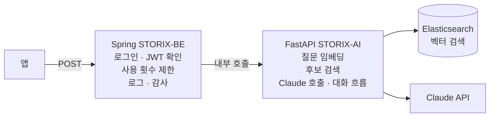
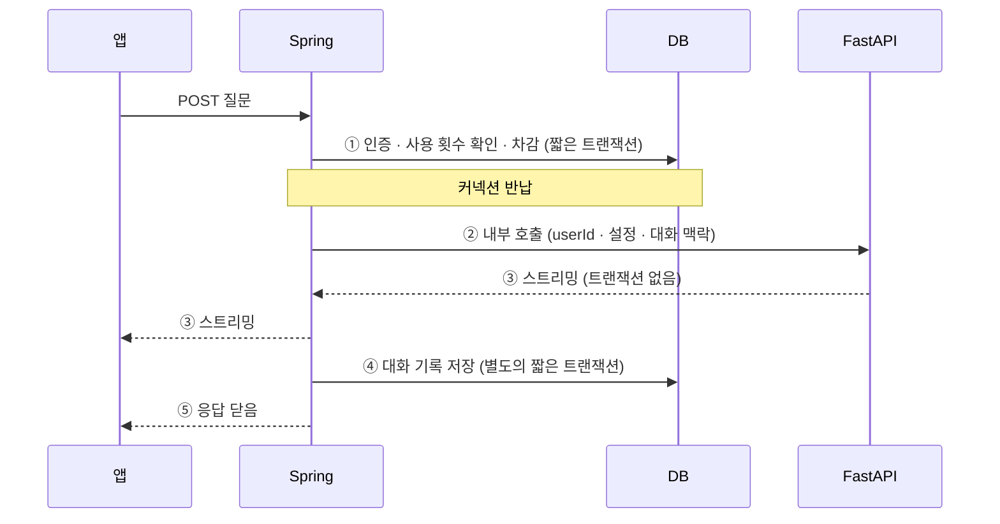

# 서빙과 스트리밍

> 상위 문서: [기술 구조](README.md) · 같은 묶음: [색인과 임베딩](indexing.md) · [레포와 API 계약](api-contract.md)

## 1. 구조



- Python 서비스는 외부에 열지 않고 Spring 만 부름. 인증 · 사용 제한은 Spring 한 곳에서
- RAG 흐름: ① 입력 → [질문 임베딩 → ES 에서 후보 찾기] → ② 프롬프트 → ③ LLM → ④ 파서 → ⑤ 결과. 검색 단계가 이 기능에서 제일 큰 작업
- LangChain 은 LLM 앱 부품 모음, LangGraph 는 분기 · 되돌아가기 · 상태 저장이 있는 에이전트 흐름을 그래프로 짜는 도구. Python 레포라 쓸 만함 (Java 쪽 대안은 LangChain4j, Spring AI)

## 2. FastAPI

"Spring MVC + Bean Validation + springdoc 을 아주 얇게 만든 것"

| Spring Boot | FastAPI | 비고 |
| --- | --- | --- |
| @RestController, @GetMapping | APIRouter, @router.get | 거의 1:1 |
| DTO(record) + @Valid | Pydantic BaseModel | 검증이 타입 선언에 붙음 |
| springdoc | 자동 생성 (/docs) | 설정 없이 |
| @Service, 생성자 주입 | Depends(...) | 함수로 주입 |
| @ControllerAdvice | @app.exception_handler |  |
| Filter, Interceptor | middleware |  |
| application.yml + @ConfigurationProperties | pydantic-settings | .env 에서 읽어 클래스로 |
| @Transactional, @Scheduled | 없음 | 직접 관리, 배치는 별도 스크립트 |
| Tomcat (스레드풀) | uvicorn (이벤트 루프) | 제일 다른 부분 |
| Gradle · JUnit + MockMvc | uv · pyproject.toml · pytest + TestClient |  |

- 고른 이유: SSE 를 StreamingResponse 로 바로 보냄, 비동기라 LLM 처럼 기다리는 시간이 긴 서비스에 맞음, Pydantic 으로 스키마 · OpenAPI 자동, LangChain · Anthropic SDK 예제가 대부분 FastAPI
- 주의
  - uvicorn 워커마다 임베딩 모델을 따로 올려서 메모리가 배로 듦 → 워커 1~2개
  - 임베딩 계산은 CPU 작업이라 async 안에서 그냥 부르면 서버 전체가 멈춤 → `run_in_threadpool` 또는 `asyncio.to_thread`
  - 싱글톤(임베딩 모델, ES 클라이언트)은 lifespan 에서 만들어 둠
  - `/health` 엔드포인트, 패키지는 uv, 타입 검사는 mypy · pyright 추천

## 3. 요청 흐름과 DB 커넥션

STORIX 는 open-in-view: false 이고 트랜잭션은 Service 에 걸려 있음. dev 커넥션 풀이 3개라 스트리밍 동안 커넥션을 잡으면 요청 3개에 바닥남



- UseCase 에 @Transactional 을 걸지 않음
- 스트림 시작 전에 DTO 로 다 바꿔 둠. 지연 로딩 필드를 건드리면 LazyInitializationException
- ④ 저장은 다른 스레드에서 돌아서 Service 빈의 @Transactional 메서드를 호출해야 프록시가 적용됨 (자기 메서드 호출 X)
- 화면을 닫거나 FastAPI 오류가 나도 ④ 가 돌도록 완료 · 오류 · 타임아웃 콜백 전부 연결. 사용 횟수를 미리 차감했다면 실패 시 되돌릴지 결정 필요
- 새로 필요한 것: spring-boot-starter-webflux(MVC 위에서 WebClient 만), `spring.mvc.async.request-timeout`

## 4. 사용자 데이터 접근

- RAG 에 필요한 건 검색할 색인이지 STORIX 원본 DB 가 아님
- AI 전용 데이터(라벨, 벡터, AI 대화 기록)는 AI 쪽이 다루고, STORIX 핵심 데이터(사용자, 리뷰 원본, 취향, 차단, 성인인증)는 Spring 이 주인
- FastAPI 가 본 DB 에 직접 붙으면 생기는 문제
  - 스키마 결합: JPA 가 바뀌면 Python 쿼리가 조용히 깨짐
  - 비공개 · 차단 · 성인 규칙 중복: 빠지면 보면 안 되는 데이터가 답변에 섞임
  - DB 커넥션 분산, AI 서비스에 본 DB 계정

| 방식 | 장점 | 단점 |
| --- | --- | --- |
| A. Spring 이 미리 담아서 넘김 | 가장 단순 · 안전 | 대화 중 필요한 정보를 그때그때 못 가져옴 |
| **B. FastAPI 가 Spring 내부 API 호출** | 규칙 · 권한이 Spring 한 곳. 대화 중에도 조회 | 내부 API 몇 개 필요 |
| C. 읽기 전용 계정으로 DB 직접 | 빠르고 유연 | 결합 · 규칙 중복 |

**결정: B.** Claude 도구("내 취향 조회" 등)가 Spring 내부 API 를 호출. 에이전트 비서까지 커져도 도구만 늘리면 됨

- `/internal/**` 경로는 리버스 프록시(Caddy)에서 외부 노출을 막고, FastAPI ↔ Spring 사이 서비스 토큰(공유 비밀값 헤더)을 두고 일반 JWT 필터와 분리
- userId 는 Spring 이 JWT 에서 꺼내 넘긴 값만 사용. Claude 가 만든 도구 입력에서 userId 를 받으면 프롬프트 조작으로 다른 사람 정보를 조회할 수 있음
- 처음 API: `GET /internal/users/{userId}/context` (취향 장르 · 해시태그, 서재 · 관심작품 ID). 형식은 [api-contract.md](api-contract.md)
- 닉네임 · 이메일은 넣지 않고, 비공개 · 차단 · 성인 규칙은 API 안에서 적용된 결과로
- 호출이 한 바퀴 도는 구조(앱 → Spring → FastAPI → Spring /internal)라 짧은 타임아웃(1~2초), 실패하면 맥락 없이 답변

## 5. SSE

|  | SSE | WebSocket |
| --- | --- | --- |
| 방향 | 서버 → 클라이언트 한 방향 | 양방향 |
| 연결 | 답변 하나 끝나면 닫힘 | 계속 유지 |
| 정체 | 바로 닫지 않고 조금씩 계속 쓰는 일반 HTTP 응답 | upgrade 된 연결 |
| STORIX | AI 답변 | 토픽룸 채팅 (STOMP) |

- 일반 HTTP 라 프록시 · CDN 을 그대로 통과하고 세션 관리가 필요 없음
- Claude 스트리밍도 SSE(message_start, content_block_delta, ping, message_stop 등). FastAPI 가 STORIX SSE 로 바꿔 내보냄: text_delta → `token`, ping → heartbeat, message_stop → `done`
- FastAPI 는 StreamingResponse, Spring 은 WebClient 로 `Flux<ServerSentEvent>` 를 받아 SseEmitter 또는 Flux 로 앱에 전달하면서 works 의 workId 검증, 끝나면 대화 저장
- 앱은 EventSource 가 GET 만 돼서 POST 스트림(fetch 스트리밍 · SSE 라이브러리) 사용
- 함정: Caddy 버퍼링 끄기, `Content-Type: text/event-stream` · `Cache-Control: no-cache`, Spring → Python · CDN 타임아웃 대비 heartbeat
- 글 먼저 → 작품 나중. 이벤트 하나 = event 줄 + data 줄 + 빈 줄
- 최종 상태 모양은 스트리밍이 끝난 뒤 앱이 모아서 가진 것이고, 대화 기록 API 는 그 모양으로 돌려줌
- 화면 모양(슬라이드, 세로 목록 등)은 앱에서 정하고 서버는 데이터만 줌. recommendedWorks 는 배열(순서 = 추천 순위)이고 카드에 필요한 값은 다 넣음
- 이벤트 형식과 예시는 [api-contract.md](api-contract.md)

## 6. 답변 레이어

1. Claude 에게 "안내 문구를 쓰고 마지막에 `recommend_works` 도구를 호출해 고른 작품 ID 와 이유를 넘겨라"(tool use). 작품을 먼저 보여 주려면 도구를 먼저 호출하게 함
2. 글 토큰은 그대로 `token` 으로. 도구 입력 JSON 은 input_json_delta 로 조각조각 오니 모아서 완성된 뒤 파싱
3. workId 가 후보 목록에 있는지 서버가 검사(지어낸 작품을 막는 마지막 안전장치)하고, 제목 · 표지 URL · 플랫폼은 DB 에서 채움. LLM 이 URL · 제목을 쓰면 틀리거나 지어낼 수 있음
4. 작품 외 질문 차단, 결과 없음 · 애매할 때 추가 질문, 오류 · 한도 초과는 LLM 이 아니라 서버 코드의 고정 문구로

## 7. 프롬프트

```
prompts/
├── system.md        # 역할 · 말투(~해요체) · 규칙 (고정)
├── examples.md      # 좋은 답변 예시 (고정)
└── user_turn.jinja  # 매번 바뀌는 부분: 질문, 후보, 대화 맥락 · 요약
```

`system.md` 예시

```markdown
너는 STORIX의 웹툰·웹소설 탐색 도우미야.

<말투>
- 친근한 존댓말, 2~3문장으로 짧게
- 이모지는 쓰지 않음
</말투>

<규칙>
- <후보작품>에 있는 작품만 추천해. 없는 작품은 언급하지 마
- 줄거리 반전이나 결말은 말하지 마
- 추천 이유는 사용자의 질문과 일치한 단서로 설명해
- 후보 중에 맞는 작품이 없으면 솔직하게 말하고, 조건을 하나 더 물어봐
</규칙>
```

- 고정 부분을 앞, 바뀌는 부분을 뒤에 둬야 프롬프트 캐싱이 걸림. `system.md` 에 날짜 · 사용자 이름을 넣으면 캐시가 깨짐
- 답변 형식은 프롬프트 대신 도구 스키마로 고정
- 프롬프트는 git 으로 관리하고 대화 저장 시 프롬프트 버전도 같이 저장. 바꿀 때마다 평가 세트로 확인 후 PR

## 8. 속도

| 구분 | 방법 |
| --- | --- |
| 실제 속도 (서버) | 스트리밍, 프롬프트 캐싱, 모델 · effort 조절(평가 세트로 확인), 후보 50개 → 10~20개로 줄이기, 질문 임베딩 속도 측정 |
| 체감 속도 (앱) | 스트리밍 글자 바로 그리기, "작품 찾는 중…" · "후보 12개 찾음" 진행 표시, 카드 스켈레톤, 실제 소요 시간 측정 |

같은 3초라도 화면에서 뭔가 움직이면 훨씬 빠르게 느껴짐

## 9. 대화 기억

- Claude 는 아무것도 기억하지 않아서 이전 대화를 저장해 두었다가 매번 같이 보냄

| 방식 | 특징 |
| --- | --- |
| 전체 기록 | 정확하지만 비용 · 속도 악화 |
| 최근 N턴 | 단순, 오래된 맥락을 잊음 |
| 요약 + 최근 | 대부분 무난 |
| 장기 기억 | 취향만 사용자별 저장. 에이전트 비서 · 다음 날 리포트에 필요 |

- 정한 것: 최근 25건 + 이미 보여 준 작품 ID + 사용자 조건을 전달. 대화 원본은 탈퇴 시까지 보관, 25건 이전은 요약해서 검색 · 답변에 반영 (v2)
- 꼭 저장할 것
  - 이미 보여 준 작품 ID: "아까 두 번째 거", "그거 말고", 중복 추천 방지
  - 사용자가 붙인 조건: "완결작만", "19금 빼고"는 요약하면 사라지기 쉬워서 구조화
- 저장 위치: 진행 중 대화는 Redis + TTL, 장기 취향은 DB (LangGraph 라면 checkpointer 와 store)
- 대화 기록은 앞에서부터 쌓이는 구조라 프롬프트 캐싱과 잘 맞음

---

작성자 : 이수아

업데이트 날짜 : 2026-11-20
