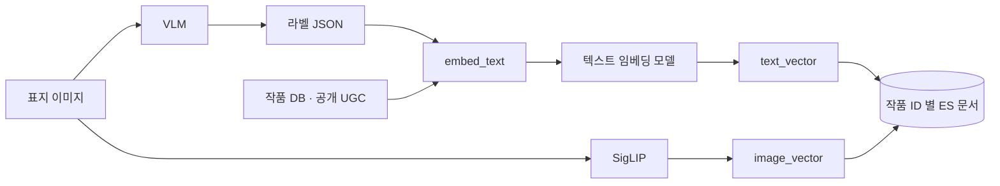

# 색인과 임베딩

## 1. 임베딩

- 글(또는 이미지)을 숫자 목록(벡터)으로 바꾸는 것. 뜻이 비슷하면 벡터도 가까움
- 키워드 검색은 글자가 같아야 찾지만, 임베딩 검색은 "은발 = 은빛 머리 = 백발"을 비슷하게 봄
- **Claude API 에는 임베딩 기능이 없다.** 로컬 모델(bge-m3, multilingual-e5 등) 또는 유료 API 중 골라야 함
- 작품과 질문은 반드시 같은 모델로 임베딩. 모델을 바꾸면 전체 재색인(Hub)
- 질문 임베딩은 서빙 서버에서 돌아서 서버 메모리 · CPU 에 맞는 크기여야 함 (양자화 · ONNX 검토)

## 2. 데이터별 색인

| 데이터 | 색인 방법 | 단계 |
| --- | --- | --- |
| 작품 DB | 설명 · 태그 · 장르를 embed_text 로 | MVP |
| 표지 | VLM 이 인물 외형 · 의상 · 배경 · 소품을 라벨 JSON 으로 → embed_text | v2 |
| 공개 UGC | 리뷰 → 피드 → 토픽룸 순서. 삭제 · 비공개 전환 시 색인에서도 제거 | v2 |
| 표지 그림체 | SigLIP 이미지 벡터 | 3단계 |



## 3. embed_text

라벨 전체 대신 검색에 잘 걸리도록 핵심만 문장으로 정리한 것

```json
{
  "characters": [
    { "role_guess": "보호자 · 남주급 성인 남성", "age_band": "20대", "hair": "흑발", "eyes": "적갈색", "outfit": "짙은 남색 제복 망토", "confidence": 0.8 },
    { "role_guess": "주인공 · 막내 여아", "age_band": "유아 (4~6세)", "hair": "은발 단발", "eyes": "보라색", "outfit": "민트색 원피스", "confidence": 0.85 }
  ],
  "scene": ["귀족 저택 실내", "파스텔 톤"],
  "embed_text": "흑발 적갈색 눈의 귀족 제복 성인 남성과 은발 보라 눈의 유아 여자아이. 육아물, 가족물, 로판, 파스텔 표지"
}
```

- 앞단: embed_text 규칙(설명이 길면 표지 특징이 묻힘), 작품당 벡터 1개 vs 여러 개, 긴 글 쪼개기, 스포일러 · 정보 없는 리뷰 제거
- 뒷단: 하이브리드 검색(벡터는 제목 · 작가명 같은 정확한 단어에 약함), 필터, 재순위, 증분 처리
- 선택지마다 좋아졌는지는 평가 세트로 확인

## 4. VLM 라벨 vs SigLIP

|  | VLM → 라벨 JSON | SigLIP → 벡터 |
| --- | --- | --- |
| 결과 | 글 (속성) | 숫자 (느낌) |
| 잘하는 것 | 머리색 · 의상 같은 구체적 특징 | 그림체 · 분위기 · 색감 |
| 설명 가능 | O (카드의 일치 단서) | X |
| 한국어 질문 | 잘 됨 | 약함 |
| 쓰는 곳 | AI 작품 검색 | 작품 상세 "그림체 비슷한 작품" |

표지가 많아서 라벨링은 로컬 VLM 으로. 1,000개로 항목 · 품질 확인 후 전체

## 5. Elasticsearch

```json
PUT works_ai_v1
{
  "mappings": {
    "properties": {
      "work_id":      { "type": "long" },
      "title":        { "type": "text" },
      "embed_text":   { "type": "text" },
      "platform":     { "type": "keyword" },
      "completed":    { "type": "boolean" },
      "adult":        { "type": "boolean" },
      "text_vector":  { "type": "dense_vector", "dims": 1024, "index": true, "similarity": "cosine" },
      "image_vector": { "type": "dense_vector", "dims": 768,  "index": true, "similarity": "cosine" }
    }
  }
}
```

- `dims` 는 실제 모델 크기에 맞춤
- `_id` = `work_id` 로 두면 같은 작품은 덮어써서 증분 반영이 쉬움
- 모델 교체는 별칭(`works_ai`)으로: 새 인덱스를 다 채운 뒤 별칭만 교체

## 6. 저장 위치

| 데이터 | 위치 |
| --- | --- |
| 라벨 원본 | Spring 쪽 RDS AI 전용 테이블 (JSON 컬럼) |
| 검색 색인 | Elasticsearch |
| 재색인용 원본 · 팩 | 비공개 S3 (STORIX-AI-Hub) |

## 7. 라벨링과 모델 학습

- 라벨링은 만들어진 모델에 표지를 보여 주고 묻는 것. 모델 학습(파인튜닝)이 아님
- UGC 를 외부 AI 로 보낼 때는 작성자 ID · 닉네임을 빼고 본문만. 개인정보 처리방침의 처리 위탁 · 국외 이전 항목 확인
