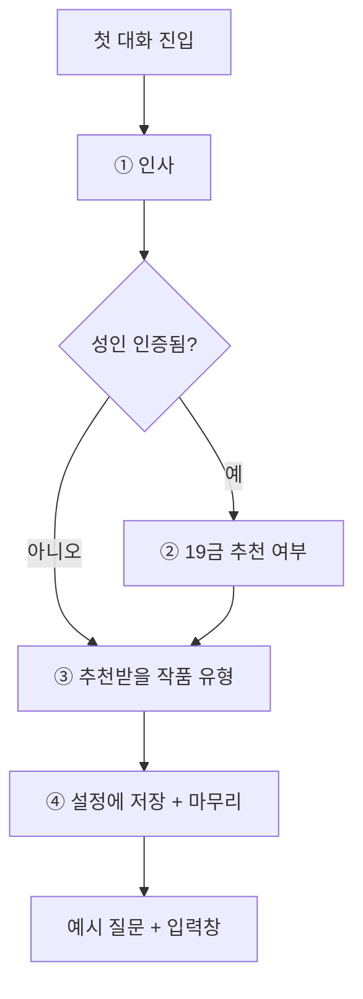

# 첫 대화 온보딩 · 챗봇 설정

온보딩은 챗봇 설정의 첫 입력을 대화처럼 보여 주는 것. 문구와 설정은 Spring 이 관리한다.

| 단계 | 멘트 | 선택지 |
| --- | --- | --- |
| ① 인사 | 안녕하세요! 저는 스토릭스 작품 탐색 도우미 ○○예요. 찾고 싶은 작품을 편하게 말해 주시면 딱 맞는 작품을 골라 드릴게요. | - |
| ② 19금 | 19세 이상 작품도 같이 추천해 드릴까요? | 같이 추천받기 / 빼고 추천받기 |
| ③ 작품 유형 | 주로 어떤 작품을 추천받고 싶으세요? | 웹툰 · 웹소설 · 단행본 · 상관없음 (여러 개) |
| ④ 마무리 | 좋아요, 고른 내용은 챗봇 설정에 저장해 뒀어요. 바꾸고 싶으면 언제든 설정에서 바꿀 수 있어요. | 예시 질문 2~3개 |

- 미성년자 · 성인 인증 전 사용자는 ② 건너뜀, 19금은 끔으로 고정
- 건너뛰기는 기본값(19금 끔, 상관없음)으로 저장

## AI 서버에서 지킬 것

- 19금은 매 질문마다 Spring 이 "설정 켜짐 + 지금 성인 인증 유효"를 확인해 넘긴 값만 쓴다
- 질문에서 19금을 요청해도 넘어온 값이 꺼짐이면 필터가 우선
- 온보딩 메시지는 모델 맥락에 넣지 않는다. 설정값은 매 질문 따로 전달된다
