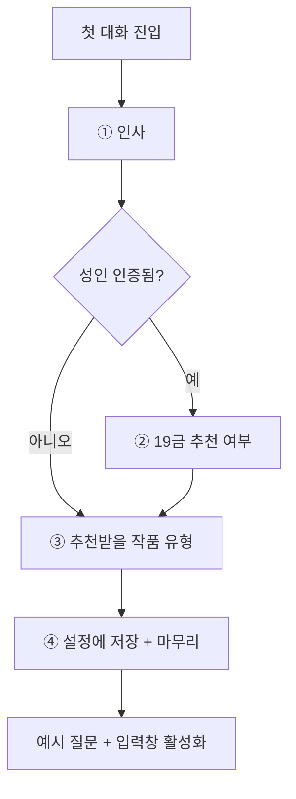

# 첫 대화 온보딩 · 챗봇 설정

> 상위 문서: [개발 계획](README.md) · 같은 묶음: [추천에 쓰이는 MVP 데이터](mvp-data.md) · [역할 분담 · 작업 순서](roles.md)

온보딩 = 챗봇 설정의 첫 입력을 대화처럼 보여 주는 것. 문구와 설정은 Spring 이 관리한다.

## 1. 흐름

## 2. 기본 멘트

| 단계 | 멘트 | 선택지 |
| --- | --- | --- |
| ① 인사 | 안녕하세요! 저는 스토릭스 작품 탐색 도우미 ○○예요. 찾고 싶은 작품을 편하게 말해 주시면 딱 맞는 작품을 골라 드릴게요. | - |
| ② 19금 | 19세 이상 작품도 같이 추천해 드릴까요? | 같이 추천받기 / 빼고 추천받기 |
| ③ 작품 유형 | 주로 어떤 작품을 추천받고 싶으세요? | 웹툰 · 웹소설 · 단행본 · 상관없음 (여러 개 선택) |
| ④ 마무리 | 좋아요, 고른 내용은 챗봇 설정에 저장해 뒀어요. 바꾸고 싶으면 언제든 설정에서 바꿀 수 있어요. 그럼 어떤 작품을 찾아 볼까요? | 예시 질문 2~3개 |

- 미성년자 · 성인 인증 전 사용자는 ② 건너뜀, 19금은 "빼고"로 고정
- 건너뛰기를 누르면 기본값(19금 끔, 상관없음)으로 저장하고 ④ 로

## 3. 챗봇 설정

| 항목 | 내용 |
| --- | --- |
| 19금 추천 | 켜기 / 끄기. 성인 인증된 사용자만 켤 수 있음 |
| 작품 유형 | 웹툰 · 웹소설 · 단행본 · 상관없음, 여러 개 선택 |
| 온보딩 버전 | 사용자가 본 온보딩 버전. 멘트를 크게 바꾸면 버전을 올려 다시 보여 줌 |
| 온보딩 멘트 | 서버에서 관리해서 앱 업데이트 없이 수정 |

## 4. API

| API | 설명 |
| --- | --- |
| `GET /api/v1/ai/chat` | 진입. 온보딩을 볼 차례면 멘트 · 선택지 · 19금 질문 노출 여부를 같이 내려줌. 대화방은 사용자당 하나라 따로 만들지 않음 |
| `GET /api/v1/ai/chat/settings` | 챗봇 설정 조회 |
| `PUT /api/v1/ai/chat/settings` | 온보딩 ④ 와 설정 화면이 같은 API 사용. 저장할 때 온보딩 버전도 기록 |

## 5. 검색 반영 규칙

| 상황 | 동작 |
| --- | --- |
| 질문에 작품 유형을 말함 | 질문 우선 |
| 질문에 말이 없음 | 설정값 사용 |
| 설정이 "상관없음"이고 질문도 애매함 | 되물어 봄 |
| 질문에서 19금을 요청했지만 설정 꺼짐 · 인증 안 됨 | 필터가 우선. "설정에서 켤 수 있어요" 안내 |
| 19금 판단 | 매 질문마다 Spring 이 "설정 켜짐 + 지금 성인 인증 유효"를 확인해 넘긴 값만 씀. 인증 해제 즉시 반영 |

## 6. 대화 기록

- 온보딩 멘트와 선택 결과는 UI 대화 기록에 남김 (`type: ONBOARDING`)
- 모델 맥락에서는 제외. 설정값은 매 질문마다 따로 전달

---

작성자 : 이수아

업데이트 날짜 : 2026-11-20
