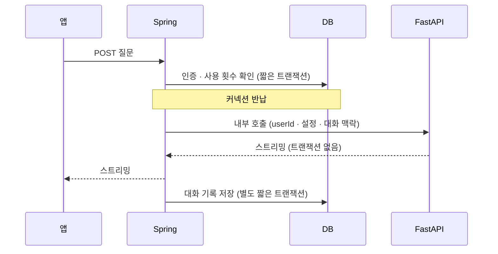

# 서빙과 스트리밍

## 1. FastAPI

| Spring Boot | FastAPI |
| --- | --- |
| @RestController | APIRouter |
| DTO + @Valid | Pydantic BaseModel |
| springdoc | 자동 생성 (/docs) |
| 생성자 주입 | Depends(...) |
| @ControllerAdvice | @app.exception_handler |
| application.yml | pydantic-settings |
| Tomcat (스레드풀) | uvicorn (이벤트 루프) |
| JUnit + MockMvc | pytest + TestClient |

- 임베딩 계산은 CPU 작업이라 async 안에서 그냥 부르면 서버 전체가 멈춤 → `asyncio.to_thread` 또는 `run_in_threadpool`
- 워커마다 임베딩 모델을 따로 올려서 메모리가 배로 듦 → 워커 1~2개
- 임베딩 모델 · ES 클라이언트 같은 싱글톤은 lifespan 에서 만들어 둠
- 패키지는 uv, 타입 검사는 pyright 또는 mypy

## 2. 요청 흐름과 DB 커넥션



- 스트리밍 동안 DB 커넥션을 잡지 않음
- 화면을 닫거나 오류가 나도 대화 저장이 돌도록 완료 · 오류 · 타임아웃 처리

## 3. 사용자 데이터 접근

FastAPI 는 STORIX DB 에 직접 붙지 않고 Spring 내부 API 를 부른다(B안).

| 방식 | 판단 |
| --- | --- |
| A. Spring 이 미리 담아서 넘김 | 대화 중 필요한 정보를 그때그때 못 가져옴 |
| **B. FastAPI 가 Spring 내부 API 호출** | **채택.** 비공개 · 차단 · 성인 규칙이 Spring 한 곳에만 있음 |
| C. FastAPI 가 DB 직접 조회 | 규칙이 두 군데로 갈리고 엔티티가 바뀌면 조용히 깨짐 |

- 사용자 ID 는 Spring 이 넘긴 값만. Claude 가 만든 도구 입력의 사용자 ID 는 쓰지 않음
- 내부 API 는 짧은 타임아웃(1~2초), 실패하면 맥락 없이 답변

## 4. SSE

| | SSE | WebSocket |
| --- | --- | --- |
| 방향 | 서버 → 클라이언트 | 양방향 |
| 연결 | 답변 하나 끝나면 닫힘 | 계속 유지 |
| STORIX | AI 답변 | 토픽룸 채팅 |

- Claude 스트림 이벤트를 STORIX SSE 이벤트로 바꿈: 글자 조각 → `token`, ping → heartbeat, 끝 → `done`
- 도구 입력 JSON 은 조각조각 오니 모아서 완성된 뒤 파싱
- 이벤트 형식은 [api-contract.md](api-contract.md)

## 5. 답변 레이어

1. Claude 에게 안내 문구를 쓰고 `recommend_works` 도구로 작품 ID 와 이유를 넘기게 함
2. 작품 ID 가 후보 안에 있는지 검사. 제목 · 표지 · 플랫폼은 Spring 이 DB 에서 채움
3. 범위 밖 질문 · 결과 없음 · 오류 · 한도 초과는 LLM 이 아니라 고정 문구

## 6. 프롬프트

```
prompts/
├── system.md        # 역할 · 말투(~해요체) · 규칙 (고정)
├── examples.md      # 좋은 답변 예시 (고정)
└── user_turn.jinja  # 매번 바뀌는 부분: 질문, 후보, 대화 맥락
```

- 고정 부분을 앞, 바뀌는 부분을 뒤에 둬야 프롬프트 캐싱이 걸림. `system.md` 에 날짜 · 사용자 이름을 넣지 않음
- 답변 형식은 프롬프트 대신 도구 스키마로 고정
- 대화 저장 시 프롬프트 버전도 같이 저장

## 7. 대화 기억

- Claude 는 아무것도 기억하지 않아서 맥락을 매번 같이 보냄
- 최근 25건 + 이미 보여 준 작품 ID + 사용자가 붙인 조건("완결작만", "19금 빼고")은 구조화해서 전달
- 대화 원본은 Spring 이 탈퇴 시까지 보관. 25건 이전은 요약해서 검색 · 답변에 반영 (v2)

## 8. 속도

- 실제 속도: 스트리밍, 프롬프트 캐싱, 후보 수 줄이기, 질문 임베딩 시간 측정
- 체감 속도: `progress` 이벤트, 카드 스켈레톤
